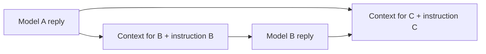

# How model nodes communicate

The original live handoff is recorded in REPORT-phase20.md; Phase 21 repairs the context and execution defects found by that verification.

An edge carries context when its consumer is run. In `A → B → C`, run A to obtain an answer, then run B: B receives A's prompt/answer plus B's own instruction. Running C includes the connected earlier material and B's answer. The application performs this assembly automatically for each requested step.

Separate HTTP requests still carry earlier replies. On the compatible-chat path, prior graph material is formatted as text inside the next user message. That enables model-to-model conversation through the graph; it does not require a peer connection between models or a provider-side conversation session.

The distinction is execution triggering: an edge does not run B when A finishes. The UI invokes runs through user actions. Run Selected now orders the selected model/summary nodes by their visible dependencies, including dependencies through intermediate source nodes. Independent branches may run together, with at most three simultaneous requests. A merge waits for its selected ancestors and consumes their fresh results. Unselected ancestors are reused without paid reruns.

Each batch uses the graph captured at its start and incorporates its own completed results immediately, without waiting for a React commit. Edits made during a batch remain in the editor but do not silently change its captured inputs. Cyclic selected plans are rejected before any model calls; individual cyclic runs remain available. Failed selected nodes cause their dependent selected nodes to be skipped, while independent branches continue; the editor displays an error notification.

## Verified behavior

- Manual A → B → C forwarding works across the inspected provider types.
- Branches can reuse a reply; a merge includes both branches and a shared ancestor once.
- A later manual run consumes the latest upstream reply, replacing the old one.
- Running B reuses available upstream data without generating A again.
- Directed cycles can be advanced manually one node at a time; there is no autonomous repeating loop. Each node keeps its current reply, rather than every previous run becoming a new permanent chat turn.
- A node's own old reply is excluded from its next run. Previous turns can be represented by earlier nodes.
- Visible Memory values are canvas-global and do not require edges. Notes text is excluded. Hidden cuts traversal through that node; an explicit visible bypass still contributes its source.

The live check requested two distinct OmniRoute model IDs: DeepSeek produced a codeword; MiMo received that reply in its actual provider payload and copied it exactly. Both usage records matched the node totals. This ran on an isolated database/uploads copy, with no owner account changes.

## Context integrity

- CSV rows are included once; row limits use the same formatter in execution and estimates. Execution reads the current stored CSV, while previews estimate the cached node contents.
- Required attachments that cannot be loaded stop execution with a readable error, rather than silently producing a response without them.
- Manually reused partial output from a failed run is explicitly labeled incomplete and unverified. A new selected batch skips dependents of its failed nodes.
- Summaries forward current responseText. Legacy summaryText is used only when the current field is absent; an empty current field cannot revive an old summary.
- Nano automatic mode follows the same visible, transitive image collector as execution, including completed custom image outputs.
- Completion snapshots use the applicable provider defaults, preserving Done status and downstream generated images. Editing an actual execution input still marks its result Edited.

Summaries retain their connected raw ancestors; they do not replace a branch automatically. Different nodes referencing the same Media ID remain distinct attachments. Hidden still cuts a whole branch, and visible Memory remains global.
