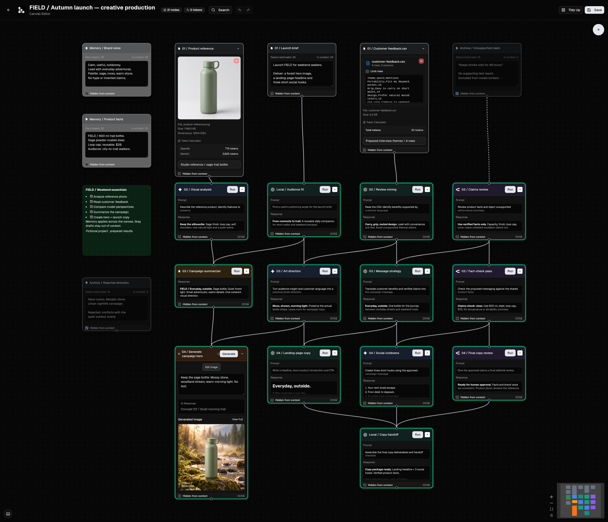
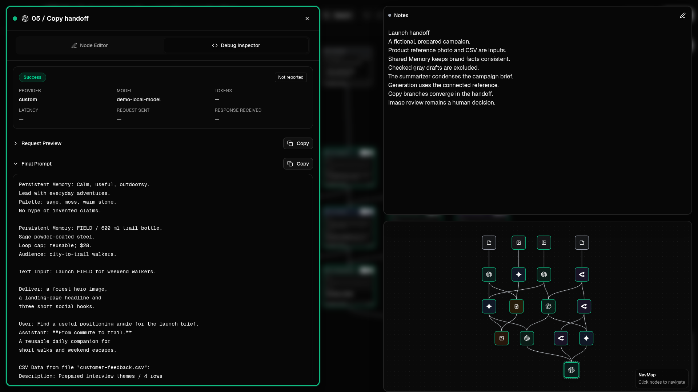
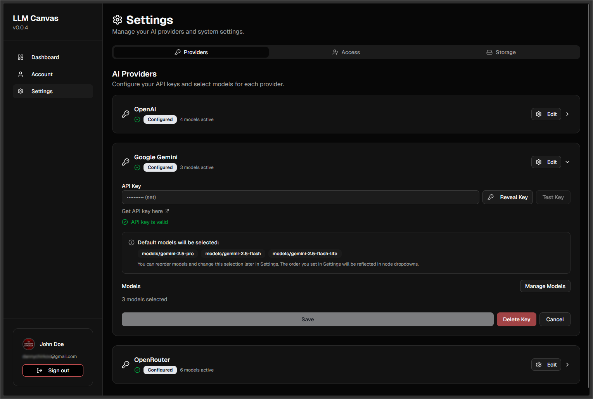

# LLM Canvas screenshots

These screenshots show the actual application with a fresh demonstration account and a fictional project. Prompts, CSV feedback and saved replies were prepared for documentation. The two product photographs were created with the built-in image-generation tool and placed in the example graph; no application provider was called to stage the captures. These are examples, not live model benchmarks. No personal canvases, real provider keys or private uploads are included.

## A complete creative project

**FIELD / Autumn launch** develops a campaign for a fictional trail bottle. Open the image at full size to inspect the 21 nodes and 21 connections.

| Stage | What the graph shows |
| --- | --- |
| Source material | A product reference photo, launch brief and customer-feedback CSV. |
| Shared Memory | Two persistent Memory nodes keep brand voice and verified product facts available across the canvas, without edges. |
| Parallel analysis | Gemini, OpenAI, OpenRouter and a custom local endpoint explore the photo, audience, feedback and supported claims. |
| Creative direction | A Summarizer composes the campaign brief; other branches develop art direction, message strategy and fact-checks. |
| Production | An image-editing node preserves the bottle in a new forest scene. Parallel copy branches create landing-page and social text. |
| Review and handoff | Copy branches converge in a handoff node; a Notes card keeps the human approval checklist outside model context. |

Two checked, faded drafts demonstrate **Hidden from context**. The unsupported claim has a dashed connection to the claims-review node, but its text does not enter the request. The separate rejected-style draft is also excluded.

Each connection uses the source's bottom handle and the target's top handle; downstream nodes sit below their sources. Layout checks verify no overlapping cards, crossings or clipped nodes. Arrows select context; use **Run Selected** to execute selected dependencies in order. A summary contributes its saved output alongside its connected raw ancestors; it does not silently replace them.

## Inspect context

The copy-handoff inspector shows both persistent memories and its assembled branch context, with the project notes and navigation map beside it. Image production and copy handoff remain parallel outputs for human approval. Prepared replies have no provider-reported billing or timing; the inspector displays **Not reported**. Token estimates and provider-reported usage have different meanings; see [tokens and caching](TOKENS_AND_CACHING.md).

## Connect your own endpoint

Use a built-in provider, an OpenAI-compatible endpoint, or a supported ComfyUI workflow. Model discovery, manual model entries and per-model context capacity are configured through the same provider settings.

See [provider protocols](PROVIDER_PROTOCOLS.md) for the supported request types and server requirements, or [download a preview](https://github.com/dannychirkov/llm-canvas/releases) to try it.
